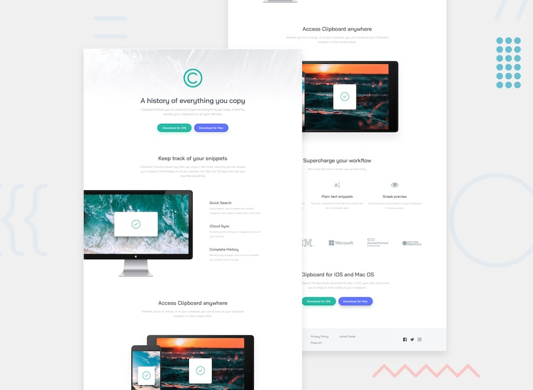

# Frontend Mentor - Clipboard landing page solution

This is a solution to the [Clipboard landing page challenge on Frontend Mentor](https://www.frontendmentor.io/challenges/clipboard-landing-page-5cc9bccd6c4c91111378ecb9). Frontend Mentor challenges help you improve your coding skills by building realistic projects.

## Table of contents

- [Overview](#overview)
  - [The challenge](#the-challenge)
  - [Screenshot](#screenshot)
  - [Links](#links)
- [My process](#my-process)
  - [Built with](#built-with)
  - [What I learned](#what-i-learned)
- [Author](#author)

## Overview

### The challenge

Users should be able to:

- View the optimal layout for the site depending on their device's screen size
- See hover states for all interactive elements on the page

### Screenshot



### Links

- Solution URL: [Front-end mentor](https://www.frontendmentor.io/home/my-challenges?tab=completed)
- Live Site URL: [Front-end mentor](https://momo97x.github.io/Clipboard-Landing-Page/)

## My process

### Built with

- Semantic HTML5 markup
- CSS custom properties
- Flex box
- CSS Grid
- Mobile-first workflow

### What I learned

#### learning a new html tag.

```html
<figure class="footer__logo-wrapper"></figure>
```

## Author

- Website - [Github repo](https://github.com/MoMo97X/Clipboard-Landing-Page)
- Frontend Mentor - [@MoMo97X](https://www.frontendmentor.io/profile/MoMo97X)
